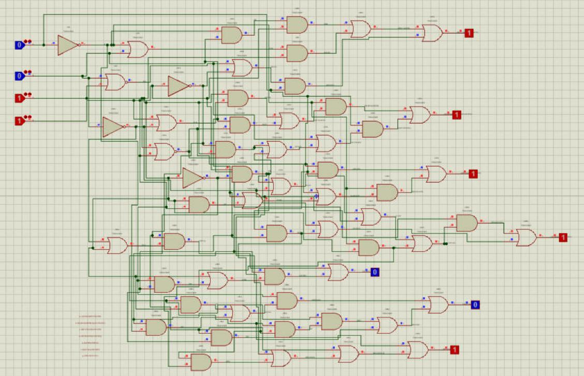

# kicad2proteus

Converts a **KiCad schematic** (`.kicad_sch`) into a **Proteus project** (`.pdsprj`) that opens directly in
Proteus 8 and can be simulated there.

The conversion is strict: the Proteus sheet shows exactly what the KiCad sheet shows (same symbols, same coordinates,
same wires and labels) and nothing is added, moved or redrawn. If something cannot be transferred exactly, no file
is written and the report says why.

> **Status: beta.** It already converts real schematics and every output is checked against Proteus itself, but the
> supported feature set is still growing (see [Not supported yet](#not-supported-yet)). Feedback and test schematics
> are welcome.



*The example decoder (`examples/7seg_decoder_sim`) after conversion, simulating in Proteus: logic state inputs on
the left, logic probes on the outputs.*

## Requirements

- Windows
- Python 3 (no extra packages)
- KiCad 10 (`kicad-cli` is used for ERC, the netlist and the plot that text positions are taken from)
- Proteus 8 Professional, tested with **8.17 SP2** (its device libraries are read for simulation models)

Default install paths are used. Other locations can be given with the environment variables `K2P_KICAD_CLI`
(path of `kicad-cli.exe`) and `K2P_PROTEUS_LIBRARY` (Proteus's `DATA\LIBRARY` folder).

## Usage

Drag a `.kicad_sch` file onto `kicad2proteus.bat`, or run

```
python k2p\k2p.py path\to\schematic.kicad_sch output\schematic.pdsprj
```

Next to the project the tool writes a report (`<name>.rapor.txt`): what was transferred, the checks that passed, and
everything it could not transfer. Reports and messages are currently in Turkish.

### Simulation parts

Add `kicad_library/Proteus_Sim.kicad_sym` to KiCad (*Preferences → Manage Symbol Libraries*). It contains
LOGICSTATE, LOGICPROBE, LOGICPROBE_BIG and 7SEG-COM-CATHODE, drawn exactly like the Proteus parts; place them in
KiCad and they become the real, interactive Proteus parts after conversion.

Other parts get their simulation model from the mapping table `k2p/eslesme.json` (KiCad symbol → Proteus model and
pin mapping). Parts not in the table are transferred with their drawing and connections, without a model.

## What is transferred

- Symbols with KiCad's own drawing (lines, rectangles, circles, arcs, filled shapes), pins with KiCad's lengths,
  inverted pins, pin names and numbers, rotation and mirroring, multi-unit parts
- Wires, junctions, local labels (horizontal and vertical), global labels, text notes
- Power symbols (GND becomes Proteus's ground) and no-connect flags
- Sheet size, title and revision, the 50 mil grid
- Simulation models: 74AUC2G gates, resistor, capacitor, LED, battery cell, CNY70, 74HC14, and the parts in
  `Proteus_Sim`

## Checks

Before a file is written the tool runs KiCad's ERC, compares the converted netlist with KiCad's own netlist, checks
that every wire end sits on a pin or a junction, and reads the written file back. The tests go one step further: each
output is compared byte for byte with the same file after Proteus has opened and re-saved it.

```
python tests\run_tests.py
```

## Not supported yet

- Hierarchical sheets and hierarchical labels
- Buses
- Mirrored power symbols and mirrored simulation parts
- Symbol text items other than in `Proteus_Sim`

## License

[MIT](LICENSE)
